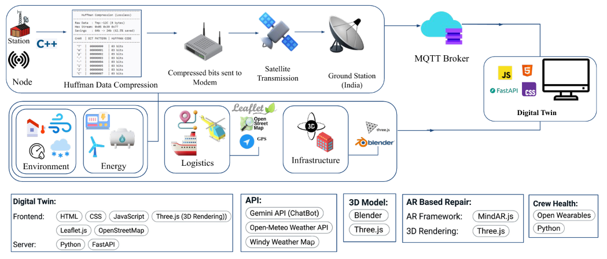
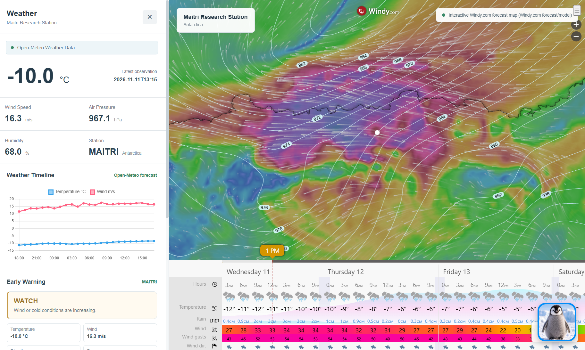
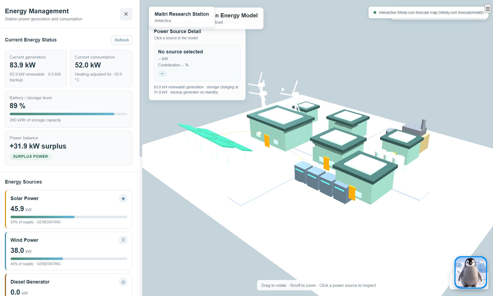
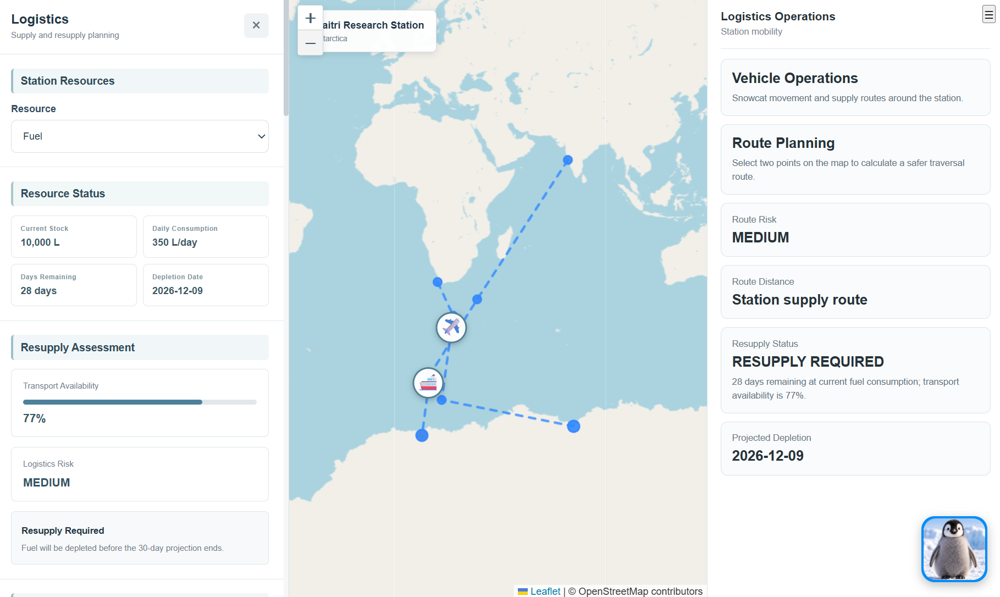
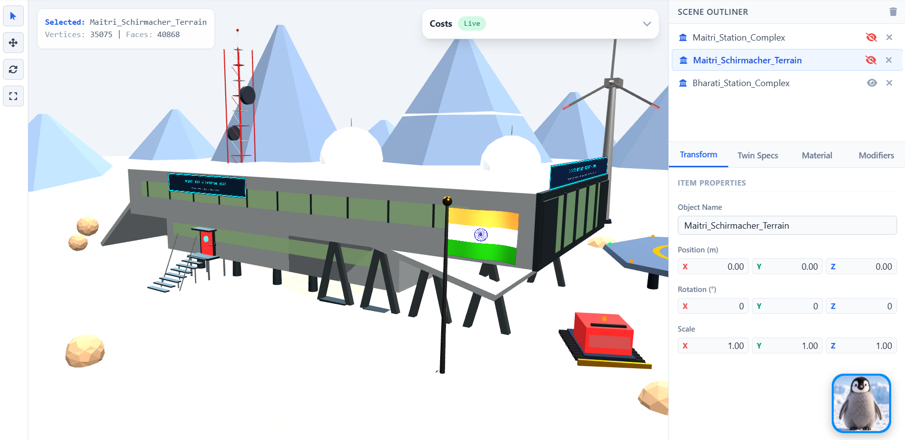
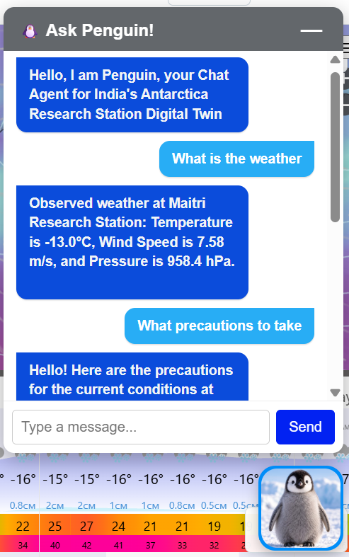

## SIH 26060
## **Team Name**: Dolphin
## **Team ID**: 143278

# Live Prototype: 

# https://dolphin-production-e8b5.up.railway.app/

# Antarctica Digital Twin

A digital platform for monitoring and managing India's Antarctic research stations, Maitri and Bharati.

# Technical Approach
 

## Features

**1)** **Weather and Environment Monitoring:** View temperature, wind speed and other weather conditions.

   
   
   **Technologies**: Open-Meteo API, Windy Weather Map, JavaScript.

   **Working flow:**
   
   - Weather information is fetched from the Open-Meteo API.
   
   - Windy provides an interactive view of weather conditions.
   
   - JavaScript displays the information in the dashboard.
 <br>
  
**2)** **Energy Management:** Monitor energy usage and test different environmental scenarios.

   
   
   **Technologies**: JavaScript, HTML, CSS.

   **Working flow**:
   
   - Energy information is presented through the dashboard.
   
   - JavaScript handles the displayed values and user interactions.
   
   - Users can explore different environmental scenarios through the interface.
<br>   
  
**3)** **Logistics Management:** View station supply and logistics information.

   

   **Technologies**: Leaflet.js, OpenStreetMap, GPS, JavaScript.

   **Working flow**:
   
   - OpenStreetMap provides the geographical map.
   
   - Leaflet.js displays the map and relevant locations.
   
   - GPS information helps represent station and logistics-related locations.

<br>   
  
**4)** **Research Station 3D View + Infrastructure Management:** Add and manage infrastructure components.

  

  **Technologies**: Blender, Three.js, JavaScript.

  **Working flow**:
  
  - Blender is used to create the 3D infrastructure models.
  
  - Three.js loads and renders the models in the browser.
  
  - JavaScript supports interaction with the 3D environment and infrastructure components.

<br>  
  
**5)** **Simulation:** Test scenarios such as extreme cold, high winds and severe storms.

   **Technologies**: JavaScript, Three.js.
   
   **Working flow**:
   
   - Users select an environmental scenario.
   
   - The application updates the corresponding simulation conditions.
   
   - Three.js is used to present the visual changes in the digital environment.
<br>
 
**6)** **AI Chatbot:** Use Penguin to ask questions and access dashboard features through simple commands.

  

   **Technologies**: Gemini API, Python, FastAPI, JavaScript.
   
   **Working flow**:
   
   - Users submit questions or commands through the chatbot interface.
   
   - The backend handles the request and connects with the Gemini API.
   
   - The response is returned to the frontend and displayed to the user.
   
   - Supported commands can be used to access dashboard features.
<br>  

## Technologies Used

- HTML, CSS and JavaScript
- Three.js
- Leaflet
- Python and FastAPI
- Open-Meteo API
- Windy
- Google Gemini API

## Installation and Setup

### 1. Clone the repository

```bash
git clone git@github.com:Midhun2468/Antarctica-Digital_Twin.git
cd Antarctica-Digital_Twin
```

### 2. Install dependencies

```bash
pip install -r requirements.txt
```

### 3. Configure API keys

Set the `GOOGLE_API_KEY` environment variable for the Penguin chatbot.

### 4. Start the backend

```bash
uvicorn main:app --reload
```

Open the local URL shown in the terminal to access the application.

## Project Details

- **Team:** Team Dolphin
- **Project:** Digital Platform for Efficient Remote Management of Indian Antarctic Research Stations
- **Repository:** [Antarctica Digital Twin](https://github.com/Midhun2468/Antarctica-Digital_Twin)
