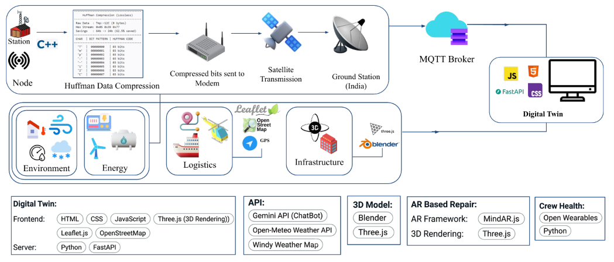
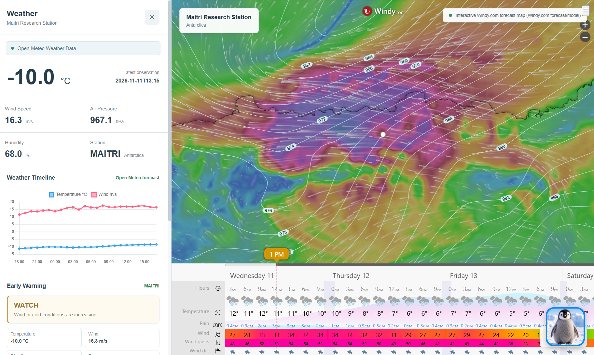
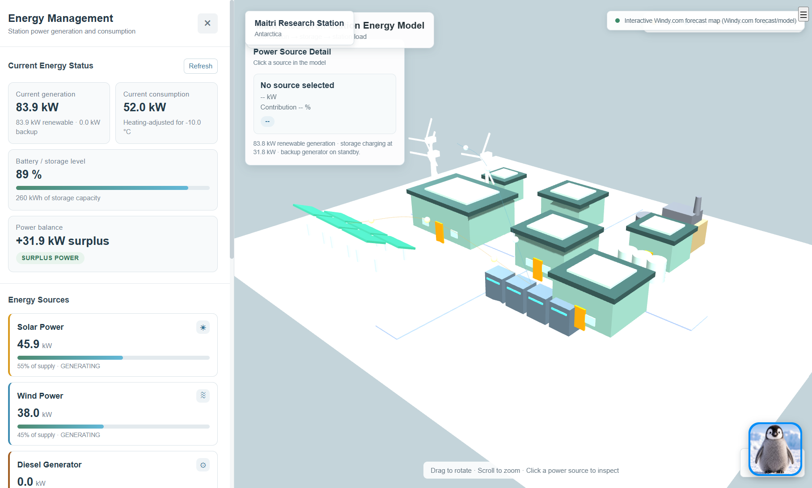
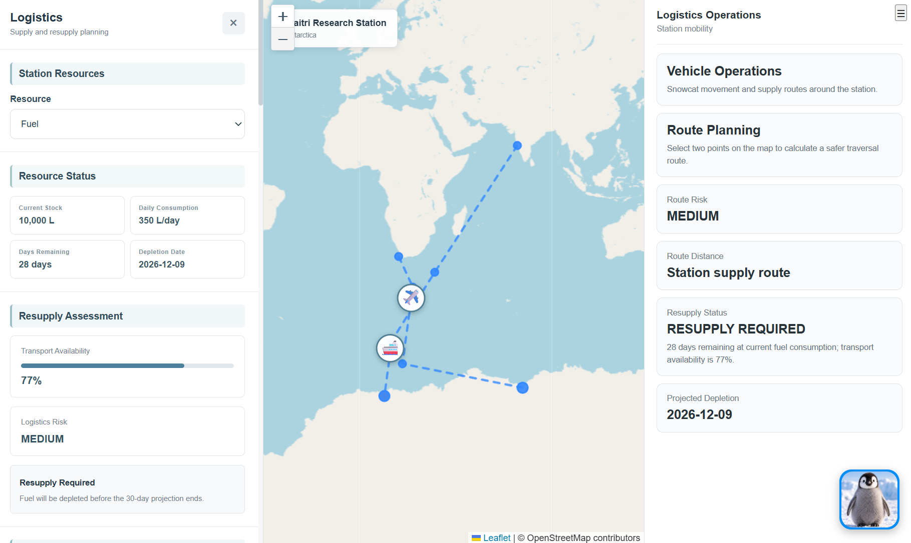
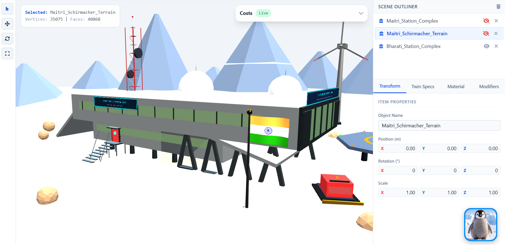
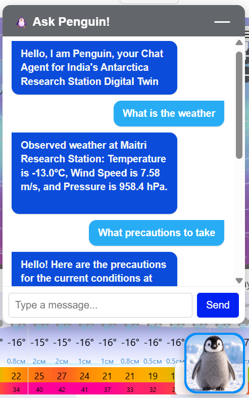

## SIH 26060
## **Team Name**: Dolphin
## **Team ID**: 143278

# Live Prototype: 

https://dolphin-production-e8b5.up.railway.app/

# Antarctica Digital Twin

A digital platform for monitoring and managing India's Antarctic research stations, Maitri and Bharati.

# Technical Approach
 

## Features

- **Weather and Environment Monitoring:** View temperature, wind speed and other weather conditions.

   
  
- **Energy Management:** Monitor energy usage and test different environmental scenarios.

   
  
- **Logistics Management:** View station supply and logistics information.

   
  
- **Research Station 3D View + Infrastructure Management:** Add and manage infrastructure components.

  
  
- **Simulation:** Test scenarios such as extreme cold, high winds and severe storms.
- **AI Chatbot:** Use Penguin to ask questions and access dashboard features through simple commands.

  

## Technologies Used

- HTML, CSS and JavaScript
- Three.js
- Leaflet
- Python and FastAPI
- Open-Meteo API
- Windy
- Google Gemini API

## Installation and Setup

### 1. Clone the repository

```bash
git clone git@github.com:Midhun2468/Antarctica-Digital_Twin.git
cd Antarctica-Digital_Twin
```

### 2. Install dependencies

```bash
pip install -r requirements.txt
```

### 3. Configure API keys

Set the `GOOGLE_API_KEY` environment variable for the Penguin chatbot.

### 4. Start the backend

```bash
uvicorn main:app --reload
```

Open the local URL shown in the terminal to access the application.

## Project Details

- **Team:** Team Dolphin
- **Project:** Digital Platform for Efficient Remote Management of Indian Antarctic Research Stations
- **Repository:** [Antarctica Digital Twin](https://github.com/Midhun2468/Antarctica-Digital_Twin)
